# Loop / Graph 設計

Mermaid 原始碼

見 [workflow.mmd](workflow.mmd)

## 各節點在做什麼

| 節點 | 做什麼 | 產出 | 由誰做 |
|---|---|---|---|
| ① 討論 | 先決定主題、讀者、長度，再開始生成 | `discussion/` | 我＋AI |
| ② 取得資料 | 搜尋、抓取網頁，寫成抽取筆記 | `raw/S#.md`、`raw/X#.md` | AI |
| 品質閘門 | 公式是否完整、內容是否相關 → 不合格就淘汰 | `wiki/sources.md` 淘汰表 | AI，依 AGENTS.md §4 |
| ③ Ingest | 一份來源更新 2～5 個概念頁；每個數字標來源 [S#] 與驗算編號 ✅V## | `wiki/concepts/`、`pipeline/claims.py` | AI |
| ④ 檢查 Wiki | `verify_math.py` 用數值積分重算每個數字；`check_wiki.py` 檢查段落、來源、連結、索引、表格 | 通過／失敗清單 | 程式 |
| ⑤ 查詢 Wiki | 依讀者需求從 index 選頁面，排出每頁簡報用哪個 Wiki 頁、哪些驗算、定義哪些術語 | `slides/outline.md` | AI |
| ⑥ 產生簡報 | 依大綱寫 HTML；每頁標 `data-wiki`、`data-checks`、`data-defines`、`data-uses` | `slides/index.html` | AI |
| ⑦ 檢查簡報 | `check_slides.py`：數字能追溯回 Wiki、術語先定義後使用、頁數；`render_check.js`：JS 錯誤、溢出、公式截斷、手機捲軸 | 通過／失敗清單 | 程式 |
| ⑧ 人工看截圖 | 看自動檢查看不出的問題（好不好讀、圖有沒有擋到字） | 若發現漏洞 → 加強 ⑦ | 我 |

一鍵跑 ④＋⑦：`bash pipeline/run_all.sh`

## 哪些步驟會重複執行？

1. **② → 品質閘門 → ②**：直到湊滿 5 份以上合格來源（這次跑了 2 輪，抓了 14 份，採用 9 份）
2. **③ ⇄ ④**：每 ingest 一次就檢查一次，失敗就修概念頁再檢查
3. **⑤ → ③**：做大綱時發現 Wiki 缺內容，回去補 Wiki（不准直接寫進簡報）
4. **⑥ ⇄ ⑦**：簡報檢查失敗就修簡報再檢查
5. **⑦ → ⑤**：術語順序錯，代表大綱本身排錯，要回到大綱
6. **⑧ → ⑦**：人工發現自動檢查漏掉的問題，就**改進檢查程式本身**，讓下次自動抓得到

## 哪些地方需要檢查或重新生成？

- **抽取品質**（②後）：網頁擷取常把公式弄丟
- **數學正確性**（④）：抽取模型會產生「看起來合理」的錯數字
- **可追溯性**（⑦）：簡報上每個數字都要能找到 Wiki 的出處
- **讀者能否看懂**（⑦）：術語不能在定義前出現
- **版面**（⑦⑧）：電腦、手機都要能看

## 為什麼這樣設計？

- **Wiki 是唯一的知識來源**：簡報只能從 Wiki 取材，所以只要 Wiki 對，簡報就對；要改內容就改 Wiki，不會發生「簡報和 Wiki 說法不一樣」。
- **數學能用程式驗算，就不要靠 AI 自己檢查**：AI 檢查 AI 很容易一起錯；數值積分不會被說服。
- **檢查越早越便宜**：錯數字如果在 ingest 時就抓到，只要改一個概念頁；等做完簡報才發現，要改 Wiki、大綱、簡報三個地方。
- **人工檢查的目的是改進自動檢查**：不是每次都靠人看，而是人看到一次漏洞，就把它變成程式。
